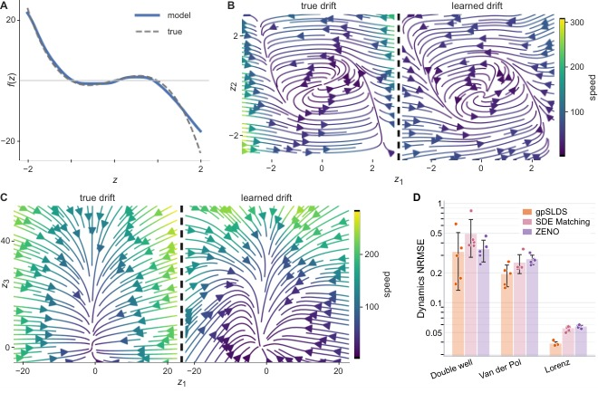

Aadi is a PhD student in the Brain and Cognitive Sciences Department at MIT, where he has been since 2024 and is mentored by [Steve Flavell](https://flavell.mit.edu). His thesis work revolves around developing connectome-constrained controllers of biomechanically realistic simulations of the nematode _Caenorhabditis elegans_ using graph neural networks. His research interests lie at the intersection of computational neuroethology and NeuroAI: developing deep learning-based tools and models to understand complex animal behaviors, in the hope that they inspire better AI algorithms. Before MIT, he completed a master's in data science and an undergraduate degree in bioinformatics at the University of California San Diego. At UCSD, he was co-mentored by [Talmo Pereira](https://talmolab.org) and [Uri Manor](https://manor.salk.edu) at the Salk Institute for Biological Studies, where he worked on deep learning models for tracking animals, cells, and organelles in video timelapses.

## Featured figure

  

*True and learned Van der Pol drift fields*

**What you are seeing.** Each panel is a map of how a hidden (latent) state, described by two variables, z1 and z2, tends to move. Every curve follows the direction of flow and the color shows how fast the state moves. The left panel is the true drift of a classic nonlinear system, the Van der Pol oscillator. The right panel is the drift that ZENO learned from noisy observations alone. Both show the same spiral toward the center and the same flow around the edges.

**Why it represents Aadi's work.** ZENO is Aadi's method for nonlinear filtering, that is, inferring a hidden state that evolves over time from noisy measurements. Recovering a known system shows the method can learn nonlinear dynamics accurately. The same problem arises when we try to infer the hidden dynamics behind neural and behavioral data.

## Publications and presentations

### Publications

- **Prasad, A.**, Flavell, S.W., DePasquale, B. (2026). *ZENO: Nonlinear filtering with Zakai Equation Neural Operators.* arXiv. [preprint](https://arxiv.org/abs/2610.32926)
