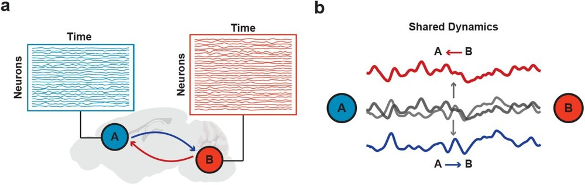

# BIO 

Omar grew up in Cairo, Egypt and received his B.E. degree in Biomedical Engineering from Stevens Institute of Technology, NJ, where he worked on a pediatric medical device for monitoring airflow following a tracheostomy. Currently a BME PhD candidate, co-advised by [Mike Economo](https://economolab.org), Omar is interested in understanding brain machine interfaces and investigating multi-region communication. Outside of work, he enjoys playing soccer, basketball, and tennis, traveling with family and friends, and playing Pro Clubs and COD.

# Current Work 

Omar is developing deep learning and statistical models to uncover inter-regional interactions from simultaneous multi-region neural and behavioral recordings in mice, characterizing the content, direction, and timing of communication across sensorimotor circuits during voluntary movement. He previously explored the influence of Motor Cortex (Mtx) cell types on the dynamics of downstream subcortical regions within the brain's orofacial circuit, using cell-type specific optogenetic perturbations to investigate how distinct cell types shape sensory-guided movements and drive unique dynamics in downstream circuits.

# Featured figure

  

*Two brain regions communicating bidirectionally*

**What you are seeing.** A schematic of the problem BiXformer solves. Two brain regions, A and B, are recorded at the same time. Each box shows the activity of many neurons over time. The regions send signals in both directions, A to B (blue arrow) and B to A (red arrow), and both end up mixed together in the same recordings.

**Why it represents Omar's work.** Omar built BiXformer, a bidirectional cross-attention transformer that separates these two streams of communication and recovers the direction and timing of signals between regions during movement. The schematic is the question behind his research on multi-region communication.

# Publications

- **El Sayed, O.**, Han, Y., Dragoi, T., Economo, M.N., DePasquale, B. (2026). *BiXformer: A Bidirectional Cross Attention Transformer for Disentangling Inter-regional Neural Dynamics.* Under review at ICLR 2027; preprint available on [bioRxiv](https://www.biorxiv.org/content/10.64898/2026.06.05.730511v1).

- Birnbaum, J.E., **El Sayed, O.**, Ugarte Nunez, J., Palmer, D., DePasquale, B., Economo, M.N. *Motor cortex differentially shapes subcortical movement dynamics through distinct descending projections* Manuscript in preparation.

# Presentations

- Birnbaum, J.E., **El Sayed, O.**, Ugarte Nunez, J.L., Palmer, D., DePasquale, B., Economo, M.N. (2025). *Motor cortex differentially shapes subcortical movement dynamics through distinct descending projections.* Society for Neuroscience Annual Meeting, San Diego, CA.
