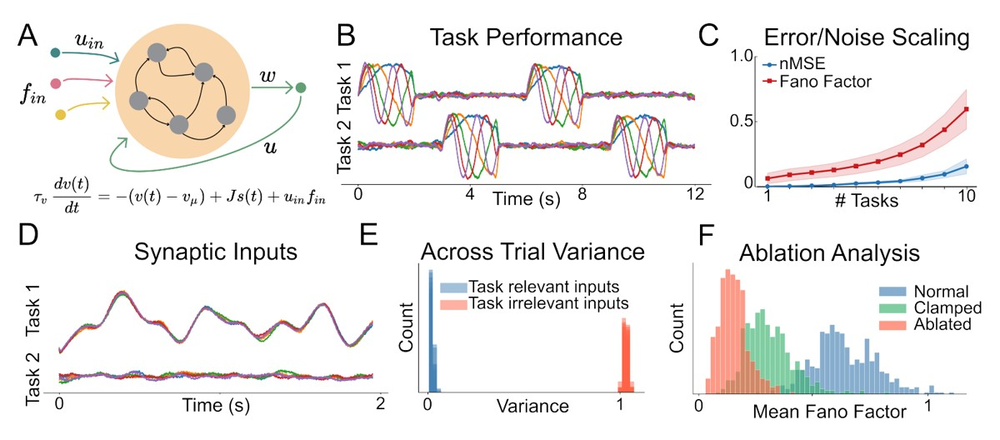

## BIO
Zach grew up outside of Memphis, TN and completed his BS in Biomedical Engineering-Bioinformatics at the University of Missouri-Columbia. Before coming to BU, he helped develop artificial minichromosome-based gene editing systems in maize with Dr. James Birchler. Later, he studied the long term effects of radiation therapies on sleep electrophysiology and cognition at St. Jude Children's Research Hospital with Dr. Ranganatha Sitaram. At BU, Zach is co-advised with [Mike Economo](https://economolab.org/) and is interested in flexible neural computation and multiregion brain communication. Outside of lab, he enjoys playing soccer, hanging with his cat Watson, and playing videogames with friends.

## Work
Zach is interested in multifunctional neural computation. His current research uses recurrent spiking neural network models to investigate how realistic biological circuits flexibly compute, specifically in relation to how variability arises in neural networks. Additionally, Zach collaborates with the [Economo lab](https://economolab.org/) to apply state-space models to multiregional communication in the mouse motor system, and contributes to [StateSpaceDynamics.jl](https://github.com/depasquale-lab/StateSpaceDynamics.jl.git), an open-source Julia package for state-space modeling in neuroscience.

## Featured figure

  

*Recurrent spiking network trained to perform multiple tasks*

**What you are seeing.** The model is a network of spiking neurons (gray circles) that are connected to each other (black arrows). Inputs (colored dots, on the left) drive the network, and a readout (right, green) reads out its activity and feeds the result back in. The equation underneath describes how each neuron's voltage changes over time: it relaxes toward its resting level, receives spikes from the other neurons in the network, and receives the external input. We train networks like this one to produce a set of patterns, one for each task.

**Why it represents Zach's work.** Zach asks why neural responses are so variable from trial to trial. He trains this kind of network on more and more tasks and finds that both its error and its spiking variability grow rapidly with the number of tasks, an indication of a tradeoff between flexibility and noise. The figure shows the model behind that result, presented at CCN 2026.

## Publications and presentations

### Publications

- Dragoi, T., **Loschinskey, Z.**, Hasnain, M.A., DePasquale, B., Economo, M.N. (2026). *Dynamic engagement of the motor cortex in controlling movement.* bioRxiv. [preprint](https://doi.org/10.64898/2026.01.13.699314)
- Senne, R.A., **Loschinskey, Z.**, Fourie, J., Loughridge, C., DePasquale, B. (2025). *StateSpaceDynamics.jl: A Julia package for probabilistic state space models (SSMs).* Journal of Open Source Software 10(115): 8077. [doi](https://doi.org/10.21105/joss.08077)

### Presentations

- **Loschinskey, Z.**, Economo, M.N., DePasquale, B. (2026). *A Fundamental Tradeoff between Computational Flexibility and Spiking Variability in Recurrent Neural Networks.* Conference on Cognitive Computational Neuroscience (CCN) 2026, New York, NY. [poster](https://openreview.net/forum?id=zCgRfzjB59)
- Senne, R.A., **Loschinskey, Z.**, Loughridge, C., Fourie, J., DePasquale, B. (2025). *StateSpaceDynamics.jl: Probabilistic State-Space Modeling.* JuliaCon 2025, Pittsburgh, PA. [talk page](https://pretalx.com/juliacon-2025/talk/DJTA7U/)
- Dragoi, T., Hasnain, M., **Loschinskey, Z.**, DePasquale, B., Economo, M. (2025). *Rapid Timescale Engagement and Disengagement of the Motor Cortex in the Control of Movement.* Lake Conference for Sensation and Action, Thun, Switzerland.
- Dragoi, T., Hasnain, M., **Loschinskey, Z.**, DePasquale, B., Economo, M. (2024). *Rapid Timescale Engagement and Disengagement of the Motor Cortex in the Control of Movement.* Society for Neuroscience, Chicago, IL.
