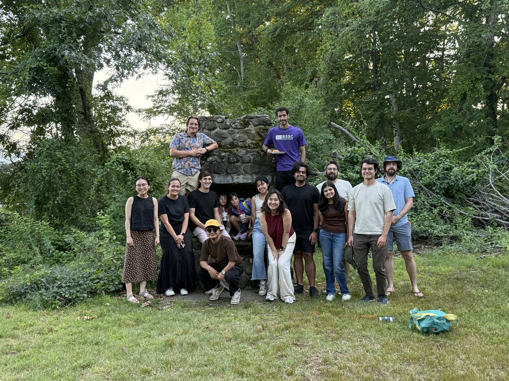
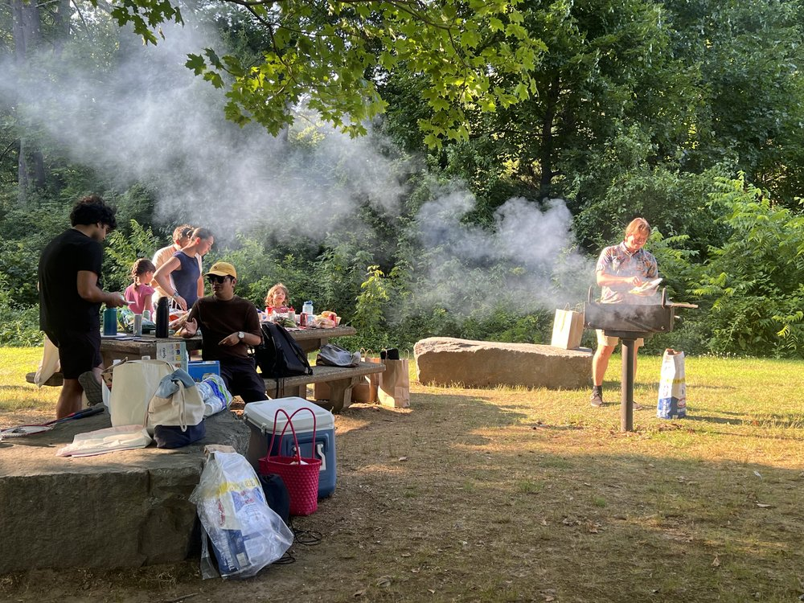
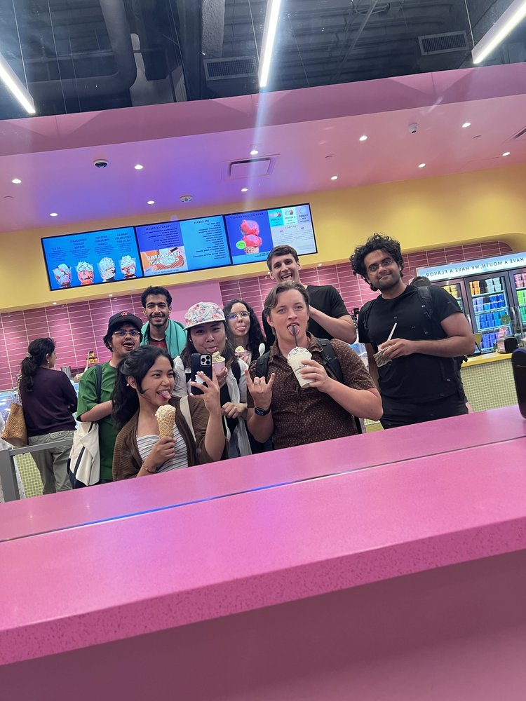
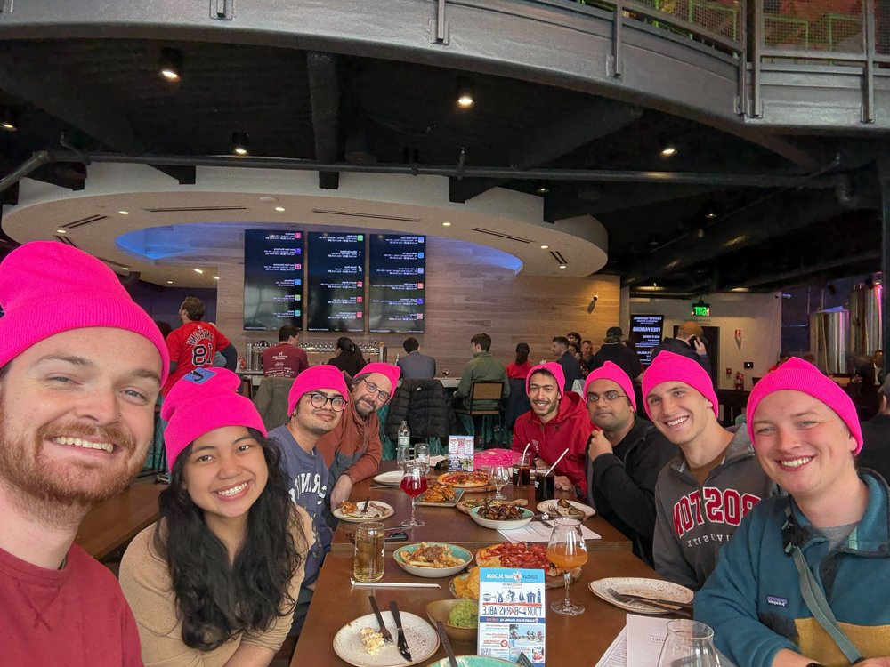
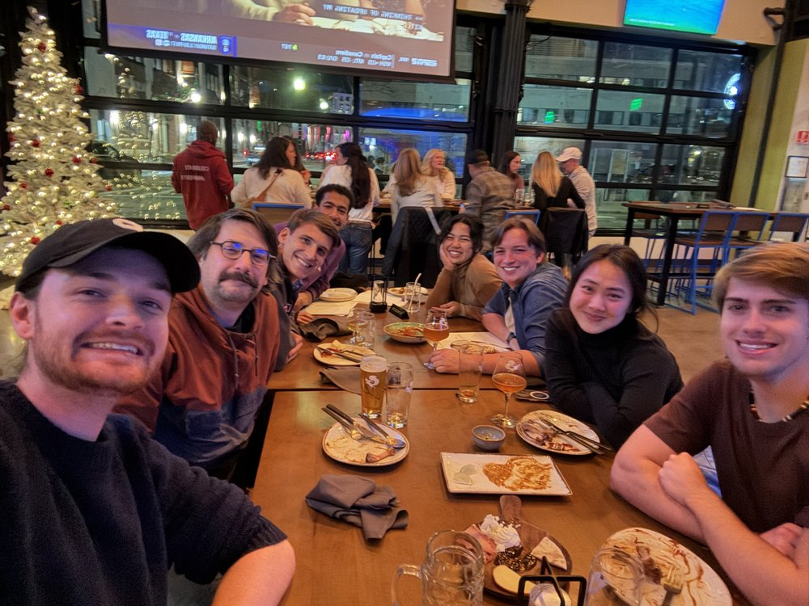
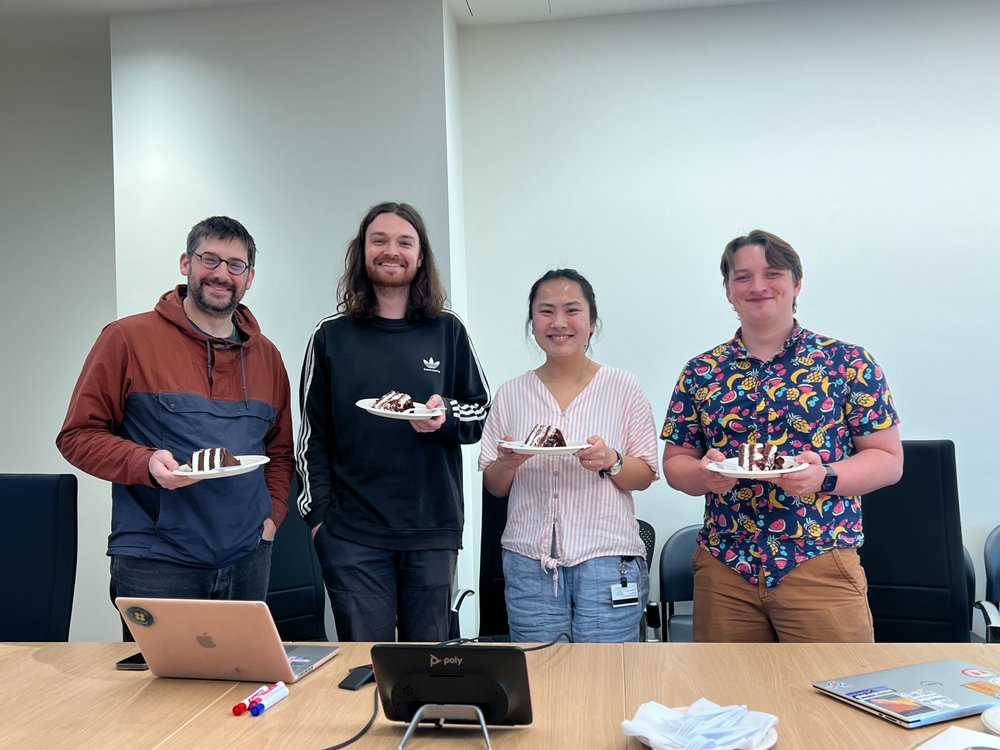
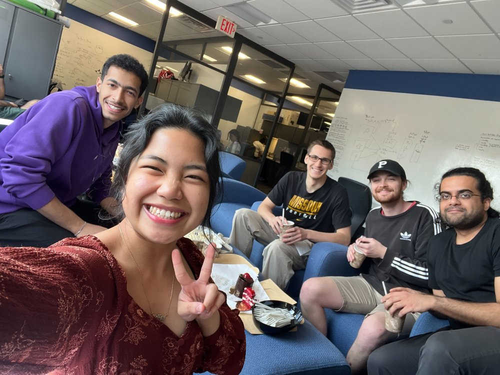
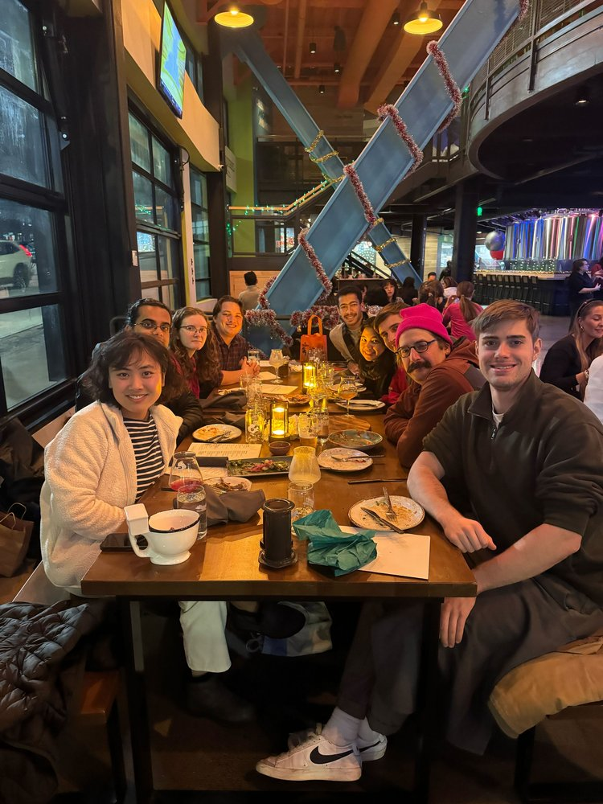
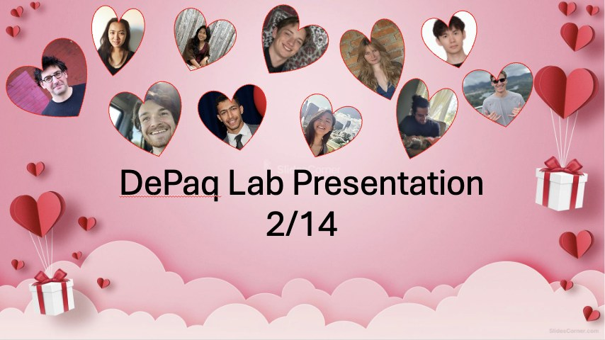

2026

Fall

* October: Congratulations to [Omar](https://depasquale-lab.github.io/members/omar-el-sayed.html) on being selected to give a talk at the Janelia conference [Data-Driven AI for Neuroscience](https://www.janelia.org/you-janelia/conferences/data-driven-ai-for-neuroscience), November 1 to 4, 2026!
* October: [Kavya Subramanian](https://depasquale-lab.github.io/members/kavya-subramanian.html), an undergraduate in the lab, wins a UROP. Congratulations Kavya!
* October: [Aadi](https://depasquale-lab.github.io/members/aadi-prasad.html) passes his qualifying exam. Congratulations Aadi!
* October: [Tushar](https://depasquale-lab.github.io/members/tushar-arora.html) passes his qualifying exam. Congratulations Tushar!
* October: [Aadi](https://depasquale-lab.github.io/members/aadi-prasad.html) posts a new preprint, [ZENO: Nonlinear filtering with Zakai Equation Neural Operators](https://arxiv.org/abs/2610.32926), a collaboration with Steve Flavell. Great job Aadi!
* September: [Ryan](https://depasquale-lab.github.io/members/ryan-senne.html) publishes a first-author paper in Nature Neuroscience, [Hippocampal astrocytic sequences emerge during learning and memory recall](https://doi.org/10.1038/s41593-026-02448-0), with Steve Ramirez and colleagues. Congratulations Ryan!
* September: [Recurrent synapses between CO2-sensitive olfactory sensory neurons enable robust CO2 detection in _Aedes aegypti_ mosquitoes](https://doi.org/10.1371/journal.pbio.3003959) is published in PLoS Biology, a collaboration with [Meg Younger](https://depasquale-lab.github.io/members/younger-lab.html) and Wei-Chung Allen Lee, with circuit modeling by Brian. Congratulations to everyone involved!

Summer

* July: Lab BBQ! Thank you to [Ryan](https://depasquale-lab.github.io/members/ryan-senne.html) for organizing it, even though we then forced him to do all the cooking. Excellent work, Ryan!

  

  

* June: [Omar](https://depasquale-lab.github.io/members/omar-el-sayed.html) passes his prospectus. Congratulations Omar!
* June: Landan Seguin rotates in the lab over the summer.
* June: [Kavya Subramanian](https://depasquale-lab.github.io/members/kavya-subramanian.html) wins the Harold C. Case Scholarship. Congratulations Kavya!
* June: Brian publishes a perspective in The Transmitter, [Models at the speed of thought: How AI coding is reshaping theoretical neuroscience](https://www.thetransmitter.org/the-big-picture/models-at-the-speed-of-thought-how-ai-coding-is-reshaping-theoretical-neuroscience/), with short responses from seven neuroscientists.
* June: [Zach](https://depasquale-lab.github.io/members/zachary-loschinskey.html) passes his prospectus. Congratulations Zach!

* June: Ice cream with the lab, just for fun.

  

* June: [Omar](https://depasquale-lab.github.io/members/omar-el-sayed.html) posts a new preprint, [BiXformer: A Bidirectional Cross Attention Transformer for Disentangling Inter-regional Neural Dynamics](https://www.biorxiv.org/content/10.64898/2026.06.05.730511v1). Great job Omar!
* June: [Ryan](https://depasquale-lab.github.io/members/ryan-senne.html) posts a new preprint, [Diurnal rhythms of choice: a novel state-dependent drift diffusion model uncovers time-dependent changes in rat decision making](https://doi.org/10.21203/rs.3.rs-9883645/v1). Great job Ryan!

Spring

* May: Brian gives a talk at the Department of Neurobiology at UCSD.

* May: Matching pink hats at a lab dinner, because we are silly.

  

* Congratulations to [Grant](https://depasquale-lab.github.io/members/grant-mcconachie.html) on his internship at DeepMind!
* April: Brian gives a talk, _Statistical and AI Methods for Scientific Discovery in Neuroscience: From Biochemistry to Circuits to Cognition_, at the Wu Tsai Neuroscience Institute at Yale.
* Brian, Diane Joseph-McCarthy, and James Galagan receive a Hariri Institute [Focused Research Program](https://www.bu.edu/hic/programs/focused-research-programs/frp-program-pages/42330-2/) award for _AI for Characterizing and Designing Biomolecular Interactions_.

Winter

* February: Brian is named a [2026 Sloan Research Fellow](https://www.bu.edu/hic/2026/02/17/boston-university-faculty-brian-depasquale-named-2026-sloan-research-fellow/) in Neuroscience.
* January: [Grant](https://depasquale-lab.github.io/members/grant-mcconachie.html)'s paper, [Low rank adaptation of chemical foundation models generates effective odorant representations](https://doi.org/10.1101/2025.11.04.686628), is accepted at ICLR 2026. Congratulations Grant!

2025

Fall

* November: [Ryan](https://depasquale-lab.github.io/members/ryan-senne.html) publishes [StateSpaceDynamics.jl](https://doi.org/10.21105/joss.08077), a Julia package for probabilistic state space models, in the Journal of Open Source Software, with [Zach](https://depasquale-lab.github.io/members/zachary-loschinskey.html), [James Fourie](https://depasquale-lab.github.io/members/james-fourie.html), and [Carson Loughridge](https://depasquale-lab.github.io/members/carson-loughridge.html). Congrats Ryan!
* November: Brian gives a talk at the Department of Biomedical Engineering at Johns Hopkins University.

* November: A lab dinner out.

  

* November: [Grant](https://depasquale-lab.github.io/members/grant-mcconachie.html) posts a new preprint, [Low rank adaptation of chemical foundation models generates effective odorant representations](https://doi.org/10.1101/2025.11.04.686628), with [Emily](https://depasquale-lab.github.io/members/emily-duniec.html), Florence Guerina, [Meg Younger](https://depasquale-lab.github.io/members/younger-lab.html), and Brian. Great job Grant!
* October: Brian speaks on the junior faculty panel at the Rising Stars in Engineering in Health workshop at Columbia University.
* October: Brian is named a [Computing & Data Sciences Faculty Fellow](https://www.bu.edu/cds-faculty/profile/brian-depasquale/).
* October: [James Fourie](https://depasquale-lab.github.io/members/james-fourie.html) is awarded UROP funding for a second semester. Great job James!

Summer

* July: [Zach](https://depasquale-lab.github.io/members/zachary-loschinskey.html) and [Ryan](https://depasquale-lab.github.io/members/ryan-senne.html) present [StateSpaceDynamics.jl](https://pretalx.com/juliacon-2025/talk/DJTA7U/) at JuliaCon 2025 in Pittsburgh.
* [Ariyana Rahman](https://depasquale-lab.github.io/members/ariyana-rahman.html) is awarded a Distinguished Summer Research Fellowship to work in the lab. Watch her [explainer video](../videos/ariyana-rahman-dpca.mp4) on finding patterns in neural activity, or see BU Engineering's [feature on her research](https://www.instagram.com/reel/DPTxayGk0yK/). Great job Ariyana!
* [Ryan](https://depasquale-lab.github.io/members/ryan-senne.html) attends the Marine Biological Laboratory (MBL) in Woods Hole.
* [Turky Alhargan](https://depasquale-lab.github.io/members/turky-alhargan.html), an undergraduate summer researcher, works in the lab with [Omar](https://depasquale-lab.github.io/members/omar-el-sayed.html).
* June: [Tushar](https://depasquale-lab.github.io/members/tushar-arora.html) and [Zach](https://depasquale-lab.github.io/members/zachary-loschinskey.html) win Hariri Graduate Student Fellowships. Congratulations Tushar and Zach!
* June: [Tushar](https://depasquale-lab.github.io/members/tushar-arora.html) is awarded a Neurophotonics Center NIH T32 fellowship. Congratulations Tushar!

Spring

* May: Brian gives a talk at the Gatsby Computational Neuroscience Unit at UCL in London.
* May: Brian, with Matthew Lovett-Barron (UCSD) and Brady Weissbourd (MIT), receives a [Scialog Neurobiology and Changing Ecosystems award](https://www.bu.edu/hic/2025/05/23/boston-university-brian-depasquale-wins-2025-scialog-nce-award/) for _A community AI approach to identify and predict behavioral motifs across marine life_.
* May: [Ryan](https://depasquale-lab.github.io/members/ryan-senne.html) passes his qualifying exam and [Grant](https://depasquale-lab.github.io/members/grant-mcconachie.html) passes the prospectus. Congratulations Ryan and Grant!

* May: Cake to celebrate [Grant](https://depasquale-lab.github.io/members/grant-mcconachie.html), [Darcy](https://depasquale-lab.github.io/members/darcy-zi.html), and [Ryan](https://depasquale-lab.github.io/members/ryan-senne.html) passing their exams!

  

* April: Brian, with Matthias Stangl and Myriam Abdennadher, receives a [Dean's Catalyst Award](https://www.bu.edu/eng/2025/04/18/deans-catalyst-awards-announced-for-2025/) for work on stress and cognition in epilepsy.

* April: Cake and coffee in the lab, just for fun.

  

* Brian gives an invited talk, _Learning the Language of Smell: Foundation Models for Protein-Odor Interactions_, at the ODIN conference at the Allen Institute in Seattle. Watch the [video](https://www.youtube.com/watch?v=2VgAzV-8xI4).
* March: Brian co-organizes the Cosyne workshop [Graph approaches to geometric complexity in neuroscience](https://sites.google.com/bu.edu/gnnworkshop-cosyne2025/home) with Kim Stachenfeld and Sam Lewallen.
* March: [Darcy](https://depasquale-lab.github.io/members/darcy-zi.html) passes her qualifying exam. Congratulations Darcy!
* March: Ted Rock rotates in the lab.
* [Zach](https://depasquale-lab.github.io/members/zachary-loschinskey.html) wins an NSF Graduate Research Fellowship (GRFP). Congratulations Zach!

Winter

* December: The lab holiday party!

  

* December: Ayla Osgood rotates in the lab.
* February: Valentine's Day (and birthday) celebration lab meeting!

  

* January: [James Fourie](https://depasquale-lab.github.io/members/james-fourie.html) is awarded the lab's first UROP. Great job James!
* January: Brittany Ahn and Joe Xie rotate in the lab.

2024

Fall

* [Grant](https://depasquale-lab.github.io/members/grant-mcconachie.html) presents his poster, [Improved odor-receptor interaction predictions via self supervised learning](https://drive.google.com/file/d/1xSKyyoDz0CszqX0tmbi3k7na8Mtzgu5B/view?usp=sharing), at NAISys at Cold Spring Harbor Laboratory. Great job Grant!
* October: Brian is named a [Scialog Fellow](https://rescorp.org/scialog/neurobiology-and-changing-ecosystems/) for Neurobiology and Changing Ecosystems.
* Congratulations to [Omar](https://depasquale-lab.github.io/members/omar-el-sayed.html) and [Halley](https://depasquale-lab.github.io/members/halley-dante.html) on winning [BU AIRR](https://www.bu.edu/hic/bu-airr/) awards!

Summer

* [Emily](https://depasquale-lab.github.io/members/emily-duniec.html) starts in the lab for the summer!

Spring

* May: Brian gives a talk at the Kempner Institute at Harvard, [Constructing spiking networks as a foundation for the theory of manifolds as computational substrate](https://kempnerinstitute.harvard.edu/events/brian-depasquale/).
* May: [Omar](https://depasquale-lab.github.io/members/omar-el-sayed.html), [Halley](https://depasquale-lab.github.io/members/halley-dante.html), [Tushar](https://depasquale-lab.github.io/members/tushar-arora.html), and [Zach](https://depasquale-lab.github.io/members/zachary-loschinskey.html) join the lab!
* May: [Ryan](https://depasquale-lab.github.io/members/ryan-senne.html) wins a Hariri Graduate Student Fellowship. Congratulations Ryan!
* Brian is named a Hariri Institute Junior Faculty Fellow.
* April: [Grant](https://depasquale-lab.github.io/members/grant-mcconachie.html) wins an NSF Graduate Research Fellowship (GRFP). Congratulations Grant!

Winter

* February: [Carson](https://depasquale-lab.github.io/members/carson-loughridge.html) joins the lab.
* February: [Grant](https://depasquale-lab.github.io/members/grant-mcconachie.html) presenting his [poster](../images/Poster_draft_2.pdf) at Cosyne 2024 in Lisbon! Awesome job Grant!

  

2023

Fall

* November: The lab had a special lab meeting at Eastern Standard where we discussed which cocktails tasted the best and how we can use LLMs in our research!

  

* October: [Grant](https://depasquale-lab.github.io/members/grant-mcconachie.html) presented his work on graph neural networks to predict olfactory receptor ligands. Great work Grant!
* October: The lab worked on their NSF applications together. Good luck everyone!
* Isaac Boyd and Mohigul Nasimova rotate in the lab.
* October: [Ryan](https://depasquale-lab.github.io/members/ryan-senne.html) finished his presentation on the role of astrocytes in fear learning.
* September: See [Ryan's](https://depasquale-lab.github.io/members/ryan-senne.html) new [bioRxiv preprint](https://www.biorxiv.org/content/10.1101/2023.09.11.556575v1) with the Scott lab on looking at the seperation of cognitive and movement representations during evidence accumulation. Congrats Ryan!

* September: The first official DePasquale lab meeting! [Ryan](https://depasquale-lab.github.io/members/ryan-senne.html) discussed his prior work in Dr. Steve Ramirez's lab looking at the role of astrocytes in fear learning. Great job Ryan!

  

Summer

* August: [Darcy](https://depasquale-lab.github.io/members/darcy-zi.html) was awarded a T32 JSTPN Early Stage Training in Neuroscience Award from GPN. Congratulations Darcy!
* July: Brian gives a talk at the OCNS workshop on [low-dimensional manifolds](https://cns2023.sched.com/event/1Kd7M/low-dimensional-manifolds-of-neural-dynamics-and-their-role-in-brain-function). 
* June: [Grant](https://depasquale-lab.github.io/members/grant-mcconachie.html) passes his qualifying exam. Congratulations Grant!

Spring

* May: Brian gives a ['Research on Tap' talk at BU](https://www.youtube.com/watch?v=lXQAFrmlqhU).

Winter

* January: The DePasquale Lab opens its doors!

