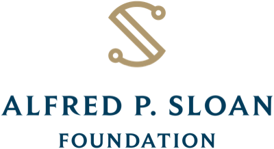

# Artificial and Biological Intelligence Laboratory at Boston University

The DePasquale lab is located in the [Department of Biomedical Engineering](https://www.bu.edu/eng/academics/departments-and-divisions/biomedical-engineering/) at Boston University. We develop mathematical models to understand how populations of neurons perform computations to produce behavior. Broadly we take two approaches. One is data-driven: we collaborate with experimental neuroscientists to develop tailored machine learning models of neural activity to identify the algorithms that drive behaviors such as decision-making or movement. Our second approach is theoretical: we construct and analyze artificial neural network models to understand how their structure gives rise to analogous computations and other functional features observed in biological neural circuits.



# Research


State inference and parameter learning for nonlinear stochastic dynamical systems is a core computation across neuroscience and engineering. We introduced the Zakai Equation Neural Operator (ZENO), which trains a neural operator against a physics-informed loss derived from the Zakai equation to approximate the unnormalized filtering distribution of a latent stochastic system. Used inside an expectation-maximization framework, ZENO performs both state inference and parameter learning, and we show that it recovers posterior distributions and stochastic dynamics in simulated double-well, Van der Pol, and Lorenz systems.

Relevant preprint: [_ZENO: Nonlinear filtering with Zakai Equation Neural Operators_](https://arxiv.org/abs/2610.32926) \\
[Prasad, A.](members/aadi-prasad.html), Flavell, S.W., DePasquale, B. (2026) \\
arXiv
{:.center}





Time of day shapes decision-making, but studying it requires continuous behavioral measurement over long timescales and models that can handle non-stationary behavior. Using an autonomous 24-hour training facility, we collected over half a million trials of rats performing a visual evidence accumulation task. We developed a state-dependent drift diffusion model, which combines a drift diffusion model with a hidden Markov model over latent states, to fit these choices and reaction times. The model reveals recurring latent states with distinct drift rate, bias, and decision-commitment time that align with feeding schedules and the light–dark cycle.

Relevant preprint: [_Diurnal rhythms of choice: a novel state-dependent drift diffusion model uncovers time-dependent changes in rat decision making_](https://doi.org/10.21203/rs.3.rs-9883645/v1) \\
[Senne, R.A.](members/ryan-senne.html), Xia, H., Duebel, H.F., Do, Q., Kane, G.A., Fourie, J., Ramirez, S., [Scott, B.B.](members/scott-lab.html), DePasquale, B. (2026) \\
Research Square
{:.center}





Simultaneous recordings from multiple brain regions mix feedforward and feedback signals within the same neural populations, which makes inter-regional communication hard to interpret. We introduced BiXformer, a bidirectional cross-attention transformer that uses directionally masked attention to separate inter-regional communication into causal and acausal streams. It recovers low-dimensional, directed latent dynamics and communication delays without assuming linearity or stationarity. BiXformer recovers ground-truth structure and delays in synthetic data, and in multi-region recordings during a movement task it reveals components consistent with sensory feedback and motor-related signals.

Relevant preprint: [_BiXformer: A Bidirectional Cross Attention Transformer for Disentangling Inter-Regional Neural Dynamics_](https://doi.org/10.64898/2026.06.05.730511) \\
[El Sayed, O.](members/omar-el-sayed.html), Han, Y., Dragoi, T., [Economo, M.N.](members/economo-lab.html), DePasquale, B. (2026) \\
bioRxiv
{:.center}





Neural responses are notoriously variable across repeated trials, yet we lack a circuit-level understanding of how this spiking noise arises and what constraints it places on computation. We hypothesize that spiking noise emerges when a circuit learns to perform many computations, reflecting a fundamental tradeoff between flexibility and noise. Training recurrent spiking networks on a set of pattern-generation tasks, we show that both error and spiking variability grow exponentially with the number of tasks learned, and that the variability is driven by synaptic input along task-irrelevant dimensions.

Relevant poster: [_A Fundamental Tradeoff between Computational Flexibility and Spiking Variability in Recurrent Neural Networks_](https://openreview.net/forum?id=zCgRfzjB59) \\
[Loschinskey, Z.](members/zachary-loschinskey.html), [Economo, M.](members/economo-lab.html), DePasquale, B. (2026) \\
Conference on Cognitive Computational Neuroscience (CCN) 2026
{:.center}





Recent advances in machine learning methods for computational chemistry have opened exciting new avenues for understanding olfaction. We are utilizing graph neural networks and self-supervised learning to identify patterns in unlabeled molecular data, generating representations of odors that are useful for predicting olfactory sensory neuron activation. These learned representations more accurately predict how individual odor molecules interact with olfactory receptors compared to existing methods.

We also showed that pre-trained chemical foundation models do not outperform classical hand-designed features on odorant-receptor binding tasks unless they are fine-tuned. Our model, LORAX, uses low-rank adaptation (LoRA) with cross-attention to build olfaction-specific odorant representations that predict odorant-receptor affinity.

Relevant paper: [_Low rank adaptation of chemical foundation models generates effective odorant representations_](https://doi.org/10.1101/2025.11.04.686628) \\
[McConachie, G.D.](members/grant-mcconachie.html), [Duniec, E.](members/emily-duniec.html), Guerina, F.V., [Younger, M.A.](members/younger-lab.html), DePasquale, B. (2026) \\
International Conference on Learning Representations (ICLR) 2026; preprint on bioRxiv
{:.center}





State-space models (SSMs) are powerful tools for modeling time series data that naturally arise in neuroscience, finance, and engineering. These models assume observations arise from a hidden latent sequence, encompassing methods like Hidden Markov Models (HMMs) and Linear Dynamical Systems (LDS). Our group built an open-source software package to implement these models in Julia called StateSpaceDynamics.jl. This modular package is designed to be fast, readable, and self-contained for the express purpose of fitting a plurality of SSMs, easily in Julia.

Relevant paper: [_StateSpaceDynamics.jl: A Julia package for probabilistic state space models (SSMs)_](https://doi.org/10.21105/joss.08077) \\
[Senne, R.A.](members/ryan-senne.html), [Loschinskey, Z.](members/zachary-loschinskey.html), Fourie, J., Loughridge, C., DePasquale, B. (2025) \\
Journal of Open Source Software 10(115): 8077
{:.center}





Biological neural networks compute differently than most artificial neural networks used in machine learning. For example, although real neurons communicate with spikes, reproducing this feature in artificial models has been a challenge. We develop methods for training biophysically detailed neural networks and use these models to understand how real biological circuits compute. Through mathematical modeling, we focus on building tighter links between biological neural networks and more abstract artificial neural network models used in machine learning.

Relevant paper: [_The centrality of population-level factors to network computation is demonstrated by a versatile approach for training spiking networks_](https://doi.org/10.1016/j.neuron.2022.12.007) \\
DePasquale, B, Sussillo, D., Abbott, L.F., Churchland, M.M. (2023) \\
Neuron
{:.center}






# Other Recent Publications & Preprints

* [Recurrent synapses between CO2-sensitive olfactory sensory neurons enable robust CO2 detection in Aedes aegypti mosquitoes](https://doi.org/10.1371/journal.pbio.3003959) \\
Bao, J., Alford, W.T., Khandelwal, A., Walsh, L., Lantz, G., Poncio, S., Serratosa Capdevila, L., Azatian, Y., DePasquale, B., Hildebrand, D.G.C., [Younger, M.A.](members/younger-lab.html), Lee, W.-C.A. (2026) \\
PLoS Biology 24(9): e3003959
* [Dynamic engagement of the motor cortex in controlling movement](https://doi.org/10.64898/2026.01.13.699314) \\
Dragoi, T., [Loschinskey, Z.](members/zachary-loschinskey.html), Hasnain, M.A., DePasquale, B., [Economo, M.N.](members/economo-lab.html) (2026) \\
bioRxiv
* [Striatum-wide dopamine encodes trajectory errors separated from value](https://doi.org/10.1038/s41586-025-10083-1) \\
Brown, E.H., [Zi, Y.](members/darcy-zi.html), Vu, M.-A.T., Bouabid, S., Lindsey, J.W., Godfrey-Nwachukwu, C., Attarwala, A., Litwin-Kumar, A., DePasquale, B., [Howe, M.W.](members/howe-lab.html) (2026) \\
Nature 652(8109): 424
* [Transitions in dynamical regime and neural mode during perceptual decisions](https://doi.org/10.1038/s41586-025-09528-4) \\
Luo, T.Z., Kim, T.D., Gupta, D., Bondy, A., Kopec, C.D., Elliott, V.A., DePasquale, B., Brody, C.D. (2025) \\
Nature 646(8087): 1156
* [A state-dependent drift diffusion model reveals mice actively explore a speed-accuracy continuum during decision-making](https://doi.org/10.1101/2025.06.02.657156) \\
[Senne, R.A.](members/ryan-senne.html), Delgado-Sallent, C., Ramirez, S., [Scott, B.B.](members/scott-lab.html), DePasquale, B. (2025) \\
bioRxiv
* [Neural population dynamics underlying evidence accumulation in multiple rat brain regions](https://doi.org/10.7554/eLife.84955) \\
DePasquale, B., Brody, C.D., Pillow, J. (2024) \\
eLife 13: e84955
* [Recurrent dynamics of prefrontal cortex during context-dependent decision-making](https://doi.org/10.1101/2020.11.27.401539) \\
Cohen Z, DePasquale, B., Aoi, M., Pillow, J. (2020) \\
bioRxiv
* [Task-dependent changes in the large-scale dynamics and necessity of cortical regions](https://linkinghub.elsevier.com/retrieve/pii/S0896627319307317) \\
Pinto, L., Rajan, K., DePasquale, B., Thiberge, S.Y., Tank, D.W., Brody, C.D. (2019) \\
 Neuron, 104(4), 810-824. e9
* [full-FORCE: A target-based method for training recurrent networks]("https://doi.org/10.1371/journal.pone.0191527")
<a href="https://github.com/briandepasquale/full-FORCE-demos" style="text-decoration: none"><i class="fab fa-github"></i> code</a> \\
DePasquale, B., Cueva, C.J., Rajan, K., Escola, G.S. & Abbott, L.F. (2018) \\
PLoS One 13(2): e0191527
* [Error-correcting dynamics in visual working memory](https://www.nature.com/articles/s41467-019-11298-3) \\
Panichello, M.F., DePasquale, B., Pillow, J.W. & Buschman, T.J. (2018) \\
Nature Communications 10, Article number: 3366
* [Building functional networks of spiking model neurons](https://www.nature.com/articles/nn.4241) \\
Abbott, L.F., DePasquale, B., Memmesheimer, R.-M. (2016) \\
Nature Neuroscience 19:350-355

For a full list of publications, see [Brian's Google Scholar](https://scholar.google.com/citations?user=dkRSv1AAAAAJ&hl=en).
{:.center}



## Acknowledgments

We are grateful for the support of our funders. Thank you.
{:.center}

  <a class="funder" href="https://www.nsf.gov">National Science Foundation</a>
  <a class="funder" href="https://sloan.org">Alfred P. Sloan Foundation</a>
  <a class="funder" href="https://rescorp.org">Research Corporation for Science Advancement</a>
  <a class="funder" href="https://www.bu.edu/hic/">BUHariri Institute for Computing, Boston University</a>
  <a class="funder" href="https://www.bu.edu/neurophotonics/">BUNeurophotonics Center, Boston University</a>

    

